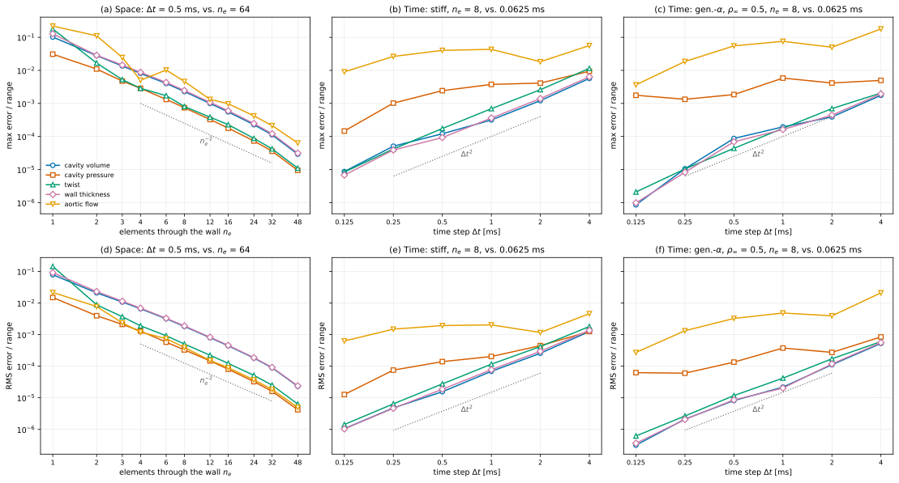
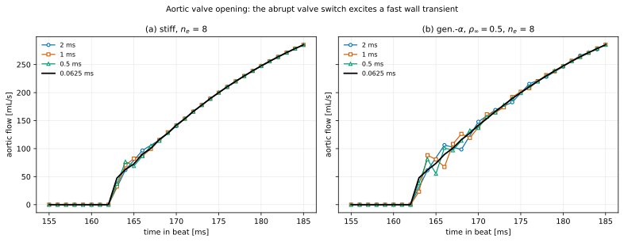
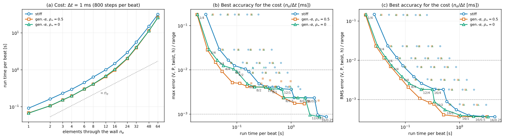
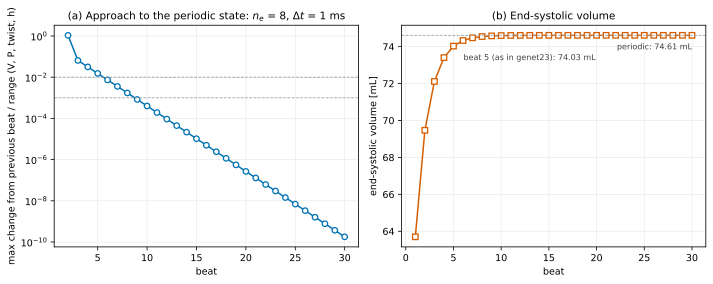

# ChamberCylinder: convergence, cost and solver settings

Which numerical settings to use with `ChamberCylinder` in practice: the number
of elements through the wall `num_elements` (n_e), the time step Δt, the
integrator, the Newton tolerance and the number of beats.

## Recommendation

| Use | n_e | Δt | RMS error | Max error | Scalars | Run time per beat |
| --- | --- | --- | --- | --- | --- | --- |
| Screening, parameter sweeps | 4 | 2 ms (T/400) | 0.7% | 0.9% | ≤ 0.5% | 0.10 s |
| Default | 8 | 2 ms (T/400) | 0.2% | 0.4% | ≤ 0.13% | 0.21 s |
| Accurate | 16 | 1 ms (T/800) | 0.04% | 0.4% | ≤ 0.03% | 1.0 s |

- **Integrator:** `"integrator": "genalpha"` with `"rho_infty": 0`. It gives
  the same solution as `"stiff"` (to 7e-13) and is 1.4-1.7× faster.
- **Tolerance:** `"absolute_tolerance": 1e-6`. Every value from 1e-3 to 1e-8
  gives the same solution; 1e-9 fails.
- **Beats:** run until the beat-to-beat change is small enough. In the genet23
  circulation that is 9 beats for 0.1%; the fifth beat that genet23 reports is
  1.4% from periodic, more than any discretization error above.
- **Refinement:** for the max error, space and time contribute equally at
  Δt [ms] ≈ 16/n_e. The RMS error and the scalars depend on space far more
  than on time, so refine n_e first.

Errors are relative to the range of each waveform over the beat: volume,
pressure, twist and wall thickness, the largest of the four. "Max" is the
largest pointwise error, "RMS" the root mean square over the beat. "Scalars"
are EDV, ESV, EF, peak pressure, peak twist and stroke work. For the default,
the RMS errors are 0.11 mL of volume, 0.05 mmHg of pressure, 0.016° of twist
and 6 µm of wall thickness; the ESV is within 0.1 mL. Its max error is the
pressure in the first milliseconds after aortic valve opening (below), 0.4
mmHg. Below 0.1% it needs Δt = 0.25 ms and n_e ≥ 12.

Run times are for one beat (800 ms) on an Apple M5, one core, with the block
branch `claude/chamber-cylinder-block` at `070e3b59` (exact tangents). This
branch's own build gives the same solutions with complex-step tangents, about
1.5× slower.

## Setup

The genet23 baseline (`ChamberCylinder_genet_exact.build`): PiecewiseValve
valves, the `linear_series_spring` active stress with its force-velocity term,
5 beats of 0.8 s, errors of the fifth beat. Each run is compared with a finer
run at the run's own output times:

- **Grid:** n_e = 1-16 × Δt = 4-0.25 ms, three integrators, against
  n_e = 32, Δt = 0.125 ms. That reference is itself within 1.2e-4 in space and
  1e-5 in time (1.5e-4 for the pressure maximum), so the smallest grid errors
  (3-4e-4) are known to about 40%.
- **Space:** n_e = 1-48 at Δt = 0.5 ms, against n_e = 64.
- **Time:** Δt = 4-0.125 ms at n_e = 8 (and 16), against Δt = 0.0625 ms.
- **Tolerance:** 1e-3 to 1e-10 at n_e = 8 and 32, Δt = 1 ms.
- **Periodicity:** 30 beats at n_e = 8, Δt = 1 ms.
- **Cost:** one beat per configuration, timed serially.

All runs except the tolerance study use `absolute_tolerance` 1e-7.

## Results



**Space** (a, d): second order for every waveform (fitted slope -2.0 to -2.1;
aortic flow -1.8 in the max norm). Volume and wall thickness have the largest
errors, about 0.15/n_e². One element is unusable (errors of 3-18%, and a twist
offset in diastole; `figures/waveforms.pdf`). Two elements give 3%, four 0.9%,
eight 0.25%.

**Time** (b, c, e, f): volume, twist and wall thickness converge at second
order; their max errors are 3-7e-4 at Δt = 1 ms and 1-3e-3 at 2 ms. Pressure
and aortic flow are limited by aortic valve opening (below), and their max
errors decay slowly and unevenly:

- **Pressure:** 0.9% at 4 ms, 0.4% at 2 and 1 ms, 0.1% at 0.25 ms.
- **Flow:** 1-6%.

Their RMS errors are 10-20× smaller. The scalars converge fastest: at 1 ms,
EDV, ESV, peak pressure, peak twist and stroke work are within 5e-5. The
temporal errors at n_e = 16 equal those at n_e = 8, so space and time errors
add independently.



**Valve opening:** when the aortic valve opens, the flow jumps and excites a
fast transient of the wall that lasts a few milliseconds. It is present in the
finest run (0.0625 ms) and is what millisecond steps do not resolve. The
L-stable scheme (ρ∞ = 0, a) damps it; with ρ∞ = 0.5 (b) the flow oscillates.

**Integrators:**

- **Plain generalized-α converges in every configuration tested** at a
  tolerance of 1e-7:
  - the grid for 5 beats, ρ∞ = 0 and 0.5;
  - n_e = 24-64 at 1 ms;
  - the regression case `chamber_cylinder_genet23.json`, also at 1e-8 and
    1e-6.

  The earlier failures were at 1e-9, below the round-off floor of the residual
  (below). At ρ∞ = 0 it is the scheme of the stiff integrator, and the results
  agree to 7e-13 (ESV 69.8424 mL in the regression case). The stiff
  integrator's line search costs an extra residual evaluation per Newton
  iteration and changes nothing here.
- **ρ∞ = 0.5** has 2-3× smaller temporal errors for volume, twist and wall
  thickness (n_e = 16 reaches 0.08% RMS at Δt = 4 ms). But the flow oscillates
  at valve opening: pressure max errors of 0.1-0.6% and flow up to 17%. Use it
  only when the valve transients don't matter.

**Tolerance:** with exact tangents Newton converges quadratically, so the last
iteration overshoots any tolerance by orders of magnitude.

- **1e-3 to 1e-8:** the same solution to 5e-10. At n_e = 8 the stiff run is
  within 4e-7 of its 1e-9 run, which took 1.7× longer, apparently by
  sub-stepping.
- **1e-9:** below the round-off floor of the residual, which grows with n_e:
  - generalized-α fails at every n_e tested (3, 8, 12, 32);
  - the stiff integrator runs up to n_e = 12, and from n_e = 16 on fails
    (n_e = 16 runs only at 0.125 ms).
- **1e-10:** every run fails.



**Cost** (a): linear in n_e up to about 16 elements, then about n_e^2.3. One
beat at Δt = 1 ms with plain generalized-α takes:

| n_e | 4 | 8 | 16 | 32 | 64 |
| --- | --- | --- | --- | --- | --- |
| Run time | 0.20 s | 0.42 s | 1.0 s | 4.1 s | 26 s |

At n_e = 64, 87% of the time is the sparse LU solve, mostly the
factorization: the global twist and axial strain couple to every node, and
Eigen's SparseLU fills in. The stiff integrator is 1.4-1.7× slower up to
n_e = 16, 1.2× at n_e = 64. The cost is almost proportional to the number of
steps (n_e = 8: 0.12 s at 4 ms, 1.3 s at 0.25 ms).

Panels (b, c) show the most accurate configuration for each cost, labeled
n_e/Δt [ms]:

- **Max error:** the front follows Δt ≈ 16/n_e.
- **RMS error:** time matters less, so the front stays at Δt = 2-4 ms up to
  n_e = 16.



**Periodicity:** the beat-to-beat change halves every beat as the arterial
pressures relax from their initial values. The distance from the periodic
beat is:

- beat 5: 1.4%, with the ESV 0.6 mL below its periodic 74.61 mL;
- beat 6: 0.7%;
- beat 9: 0.08%;
- beat 12: 0.009%.

The EDV is set by the prescribed atrial pressure and is constant from the
first beat. The number of beats depends on the circulation and its initial
state, not on the cylinder.

**Robustness:**

- **Δt = 8 ms (T/100):** fails for every n_e with a singular Jacobian. It runs
  with the active stress switched off, and 6.4 ms runs.
- **Every other configuration** ran at 1e-7, and at 1e-8 where tested.

## Running

From the repository root, with the Python module of a build on the PYTHONPATH:

```bash
python scripts/ChamberCylinder/convergence/run_convergence.py run --workers 4
python scripts/ChamberCylinder/convergence/run_convergence.py cost
python scripts/ChamberCylinder/convergence/run_convergence.py report
```

- **`run`:** the 163 accuracy runs, about 20 min with 4 workers. They are
  cached in `scripts/ChamberCylinder/output/convergence/`.
- **`cost`:** one beat of each configuration, serially, about 10 min. Don't
  run anything else meanwhile.
- **`report`:** writes `results.json` (all errors, orders and timings) and the
  figures (PDF; SVG for GitHub), and prints the tables. Format `results.json`
  with prettier before committing; CI checks every JSON file.

| File | Content |
| --- | --- |
| `run_convergence.py` | the studies, the runs and the error metrics |
| `convergence_report.py` | tables, recommendation and figures |
| `results.json` | errors, observed orders, tolerance, periodicity and cost |
| `figures/` | convergence, cost, waveforms, valve opening, periodicity |
